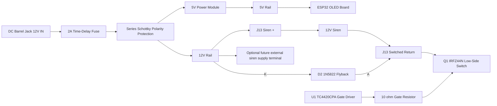
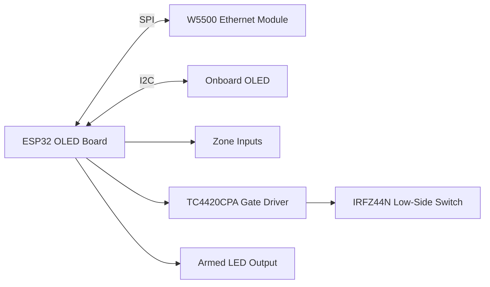

# First Pass PCB Schematic and Layout Draft

This draft turns the current prototype into a first-pass PCB floorplan and schematic arrangement.
It keeps the layout as close as practical to the original perfboard build while adapting to the new PCB form factor, W5500 support, and the provisional 110 mm x 80 mm board outline.

## Assumptions Locked In

- Board outline: 110 mm x 80 mm, including the W5500 RJ45 notch; the replacement case will be designed around this board.
- Mounting holes: 2 mm diameter, non-plated, 2 mm inset from each corner.
- Terminal blocks: 2.54 mm pitch, along the top edge where possible.
- Power input: 2.1 mm x 5.5 mm center-positive barrel jack.
- Power module: 15 mm x 20 mm module, left side of board, 5-pin footprint, 4 used pins plus unused EN.
- ESP32 module: ideaspark ESP32 OLED board, 58 mm x 31.5 mm, rotated 180 degrees so its antenna extends beyond the right PCB edge and the USB connector faces inward.
- W5500: pluggable module mounted upside down with its right edge flush to the host PCB edge; provide an edge-open RJ45 notch with 1 mm clearance on three sides.
- Siren support: single 12 V siren only for this revision.

## Layout Goals

1. Preserve the feel of the original prototype.
2. Keep the lower edge as a sensor-input zone using grouped 3-wire terminal blocks.
3. Place the two dedicated 2-pin 12V/GND accessory terminals inline with five active zone blocks and spare J7 at the ends of the bottom connector row.
4. Place the switched 2-wire siren terminal block on the top edge, not the bottom edge.
5. Keep all heavier or taller modules near the board edges where clearance is easiest.
6. Keep the ESP32 and W5500 close enough for short SPI routing.
7. Keep the power path short and wide.

## Proposed Board Floorplan

### Left-Side Power and Siren Area

- J1: center-positive barrel jack lower on the left board edge.
- F1/D1: 2 A time-delay fuse followed by the series reverse-polarity Schottky, above the barrel jack and capacitor row.
- J8: 15 mm x 20 mm pluggable power module socket shifted left; its five-pin row aligns with J9's lower 15-pin row.
- J13 is shifted right along the top edge; Q1 sits between it and the W5500 area.
- R1-R4: 10 kΩ external pull-ups for Z7/Z8/Z9/Z10, in order, below J9 and above the bottom connector row.
- Keep the converter and high-current power/siren parts left of the W5500/ESP32 stack.

### Center and Right Area

- Place C1-C3 in a vertical column between the resistor column and the ESP32/W5500 stack; shift this column 2 mm left to absorb the board-width reduction.
- Rotate the ESP32/OLED carrier 180 degrees and shift it right so its D23/EN header pads are 2.0 mm from the right board edge (1.1 mm copper-edge clearance).
- The carrier's antenna area then extends beyond the right board edge; keep the antenna clear of the host PCB and surrounding enclosure hardware.
- The USB connector is on the opposite, inward-facing end; preserve its approach clearance.
- Keepout should accommodate the 58 mm x 31.5 mm board size, with the header rows centered along the long edges.
- Keep the ESP32 mounted high enough to clear the lower terminal blocks.
- Leave enough room under the module for signal routing and status LED visibility.
- Verify the USB opening and W5500 RJ45 overhang do not compete for the same right-edge clearance during combined module placement.

### Right Edge

- W5500 module mounted upside down above the ESP32 on its 2x5 header footprint, with its right edge flush to X=110 mm.
- The RJ45 housing occupies the right-edge notch at X=90.7..110 mm, allowing the W5500 header pins to engage fully in the host sockets.
- Two Ø3 mm module mounting holes beside the RJ45 pass through the host PCB for case support.
- Maintain the 31.1 mm outside-header-pin to RJ45-body distance from the authoritative W5500 drawing.

### Bottom Edge

- Keep the lower edge visually and functionally similar to the original prototype.
- Use five active 3-wire terminal blocks for zone pairs; retain J7 as a spare NC/GND/NC block.
- Center pin on each block is common/ground.
- Bottom-row connector order, left to right: J11, J2, J3, J4, J5, J6, J7, J12.
- Target 1.5 mm to 2.0 mm body-to-body clearance between adjacent blocks where board space allows.
- Suggested zone grouping:
  - Block 1: Zone 1, GND, Zone 2
  - Block 2: Zone 3, GND, Zone 4
  - Block 3: Zone 5, GND, Zone 6
  - Block 4: Zone 7, GND, Zone 8
  - Block 5: Zone 9, GND, Zone 10
  - Block 6 (J7): NC, GND, NC; spare connector
- Place J11 and J12 at the left and right ends of the same bottom row, respectively.
- Keep the bottom edge otherwise clear so sensor blocks remain the primary lower-edge wiring interface.
- Preserve visible separation between adjacent terminal blocks: target 1.5 mm to 2.0 mm gap between neighboring block bodies where board space allows.

## First-Pass Schematic Block Diagram

### Power Path

### Logic / Communication

## Connector Draft

### Bottom Edge 3-Wire Sensor Blocks

Each block is a 3-position terminal block with center pin tied to ground/common.

- J2: Z1 / GND / Z2
- J3: Z3 / GND / Z4
- J4: Z5 / GND / Z6
- J5: Z7 / GND / Z8
- J6: Z9 / GND / Z10
- J7: NC / GND / NC (spare)

### Power and Support

- J1: DC barrel jack, pin 1 center-positive 12 V input; pins 2 and 3 are GND.
- J8: 5-pin power-module header footprint, with one pin unused (EN).
- J9: ESP32 header set.
- J10: W5500 header set.
- J11: 2-pin accessory terminal, 12V / GND (left end of the bottom connector row).
- J12: 2-pin accessory terminal, 12V / GND (right end of the bottom connector row).
- J13: 2-pin switched siren terminal block on top edge.

## Suggested Net Assignment

### Zone Nets

- Z1 -> GPIO23
- Z2 -> GPIO19
- Z3 -> GPIO18
- Z4 -> GPIO17
- Z5 -> GPIO16
- Z6 -> GPIO4
- Z7 -> GPIO35 (D35)
- Z8 -> GPIO34 (D34)
- Z9 -> GPIO39 (VN)
- Z10 -> GPIO36 (VP)

### W5500 Nets

- 5V -> 5V rail
- 3V3 -> 3.3V rail
- GND -> ground
- MISO -> GPIO26
- MOSI -> GPIO25
- SCLK -> GPIO13
- SCS -> GPIO27
- RST -> optional / default unused
- INT -> optional / default unused
- NC -> no connect

### Power Module Nets

- IN+ -> 12 V from barrel jack
- IN- -> ground
- OUT+ -> 5 V rail
- OUT- -> ground
- EN -> no connect in current design

## Placement Notes

- Keep the sensor terminal blocks on the bottom edge to match the original build behavior and wiring style.
- Keep the barrel jack on an outside edge with the center-positive silkscreen marking.
- Keep the power module close to the left side of the board and adjacent to the bulk capacitors.
- Keep J11 and J12 inline at the ends of the bottom sensor row, with 1.5 mm to 2.0 mm gaps between adjacent terminal block bodies where possible.
- Place the switched siren terminal block on the top edge so it stays clear of the bottom sensor row.
- Keep the ESP32 and W5500 close enough that their signals can be routed without vias where possible.
- Keep high-current siren traces away from the zone input routing.
- Use silkscreen outlines for ESP32, W5500, and power module with orientation cues.
- Keep each terminal block visually distinct by leaving 1.5 mm to 2.0 mm spacing between adjacent blocks where possible.

### Capacitor Callout Plan

Use one visible bulk capacitor per main rail and label each one by the rail it supports:

- 12V rail capacitor: place near the barrel jack and input protection stage, labeled `12V CAP`.
- 5V rail capacitor: place next to the power module output and 5V distribution point, labeled `5V CAP`.
- 3.3V rail capacitor: place near the ESP32 / logic rail feed, labeled `3V3 CAP`.

The intent is to make the board self-documenting at a glance. The PCB silkscreen should name the rail, while the exact capacitance and voltage rating remain in the BOM and assembly notes.

## First-Pass Layout Priority Order

1. Lock board outline and mounting holes.
2. Place the bottom-edge sensor blocks and verify they fit within the 80 mm provisional board height.
3. Place barrel jack and power module on the left side.
4. Place J11, J2-J7, and J12 in order along the bottom edge, preserving the target body gaps.
5. Place the switched siren terminal block along the top edge.
6. Place ESP32 and W5500 on the right half with the W5500 overhang to the edge.
7. Route power and siren paths.
8. Route zones and pull-up resistors.
9. Add silkscreen labels and orientation markers.

## Notes For The Next CAD Pass

This is a first-pass floorplan only. It is intended to guide KiCad schematic capture and a rough board layout, not to lock exact footprint coordinates.

The next CAD pass should verify:

- exact connector footprints from the actual assortment parts
- exact ESP32 header row spacing and module keepout
- W5500 RJ45 overhang to enclosure clearance
- barrel jack footprint hole pattern
- trace widths for 12 V and siren current paths
